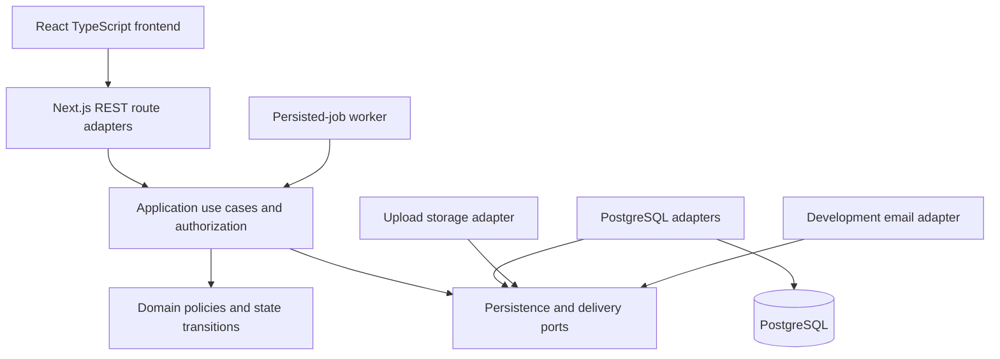

# Architecture proposal

Status: proposed product architecture. Business modules, classes and GoF patterns are not implemented. Stage 00 now includes rendered [Use Case, whole-system class and pattern collaboration diagrams](MODELING.md), with editable sources. Infrastructure delivery is tracked separately in PROGRESS.md; diagrams do not imply implemented business behavior.

## Shape of the system

Use a modular monolith for the Next.js REST backend and a separate React TypeScript frontend. PostgreSQL is the transactional authority. Shared file storage holds uploads. A separate worker process uses the same backend build and persisted database state. This keeps cross-feature booking compensation within a database transaction without introducing distributed-service overhead.

Arrows through adapters describe proposed wiring, not a deployed topology. Domain code must not depend on Next.js, ORM types or browser concerns. Application ports are implemented by infrastructure and wired in a composition root. Route adapters validate transport, establish authenticated context and call application use cases; business rules are enforced server-side regardless of UI state.

| Layer | Responsibility | Proposed location, not existing source |
|---|---|---|
| Transport | REST DTO validation, authenticated context, error mapping | `src/app/api/` |
| Application | Commands/queries, ownership, transaction boundary and coordination | `src/modules/<module>/application/` |
| Domain | State transitions, eligibility, pricing and invariants | `src/modules/<module>/domain/` |
| Infrastructure | PostgreSQL repositories/migrations, uploads, email and simulator adapters | `src/modules/<module>/infrastructure/` |
| Composition/worker | Wire dependencies; claim and execute persisted jobs | `src/composition/`, `src/worker/` |
| Frontend | Role routes, forms, query state, typed API integration and presentation | Separate frontend `src/` structure to be chosen in stage 01 |

## Modules and ownership

| Module | Owns and coordinates |
|---|---|
| Identity | Account, exclusive role profiles, password hashes, sessions, revocation, admin creation |
| Reference data | Cities/directions and deactivation rules |
| Catalog | Organizer listings, events, sessions, ordered photos, moderation and edit rules |
| Bookings | Capacity reservation, state history, deadlines, cancellation permission and changed-event entitlement |
| Payments | Simulated attempts, idempotency keys, receipt and once-only refunds; only cardLast4 persists |
| Subscriptions | Plans/purchases, scope/validity, visit reservation/restoration and corporate eligibility |
| Loyalty | Level configuration, award snapshots, ledger, free quota and ordered pricing; unresolved decisions stay explicit |
| Communications | Conversations/messages, unread/read markers, notification matrix, outbox/templates/preferences |
| Administration | Authorized application workflows across modules, safe cascades and audit reasons; no chat-content access |
| Reporting | Read-side aggregates and recommendations using persisted source records, enforcing organizer scope |
| Scheduling | Persisted job claims/retries/deadlines/reminders; delegates business actions to owning use cases |

Cross-module changes go through application interfaces, not another module's internal tables from arbitrary route code. Administration orchestrates existing cancellation use cases rather than duplicating financial rules. Reporting may use dedicated read queries but cannot mutate source records. Upload authorization and file validation precede storage; database metadata refers to stored files.

## Transaction and failure design

Booking creation must lock/serialize relevant session capacity, active user/session uniqueness and any applicable subscription/quota/points resources. Use database constraints where representable (such as active-booking uniqueness) plus transactional checks for sums and eligibility. A hall slot is an exclusive reservation unit independent of its informational people capacity. Establish a consistent lock order and retry only known transient database errors; write meaningful concurrency tests using PostgreSQL.

Persist booking price, original award, selected rules and reasons as historical snapshots. A later price/multiplier/configuration change must not alter existing charges or reversal amounts. Money uses exact arithmetic and explicit rounding; timestamps use instants, while monthly quota/display use Europe/Kyiv. Q-01/Q-02/Q-03/Q-04 must be decided before their affected predicates are accepted.

State transition, release/refund/restore/reversal records and outbox intents are committed atomically. Each effect has a stable unique business key; a retry observes existing work instead of repeating it. The payment simulator has no external financial side effect, making once-only persisted results achievable transactionally. Email delivery is inherently retryable: deduplicate notification/outbox creation and retain send outcomes; do not claim universal exactly-once external delivery across crashes. Leased job claims and persisted retry state survive process restarts.

Deleted records remain available for history. Blocking revokes active login sessions immediately; hiding a blocked organizer does not cancel existing bookings. The last-active-admin check must serialize competing changes. Contacts are projected to an organizer only for that organizer's active/completed bookings. Administrators never receive chat bodies.

## Proposed GoF patterns

These are justified candidates, not a target count or implemented-pattern list. A table-driven rule is preferable if a full object hierarchy adds no useful variation.

| Pattern | Proposed application and roles | Why and how it composes |
|---|---|---|
| Strategy | Event-kind seat/confirmation policy; subscription eligibility policy; loyalty-benefit policy | Different stable policies share a narrow interface. Booking creation selects the kind policy, then eligibility and benefit policies. Policies calculate decisions; application code owns persistence. |
| State | Booking lifecycle with guarded state-specific operations | Centralize allowed transitions and terminal-state behavior instead of scattering status switches. Application transition service coordinates resulting capacity/financial effects. Use a transition table first if concrete State objects are not justified. |
| Chain of Responsibility | Ordered pricing handlers: effective price, free quota, card discount, optional redemption | Each handler receives the pricing context and forwards to the next, recording the breakdown. Subscription payment takes an explicit alternate path. If implemented as a plain ordered function pipeline, describe it as a pipeline rather than falsely claiming GoF Chain of Responsibility. |
| Observer | Domain-event subscribers for notification intents and reporting/loyalty reactions | Multiple consumers react to one persisted business event. Synchronous invariant-critical effects stay in the transaction; asynchronous observers use an outbox, with idempotent handlers. Avoid volatile in-memory delivery for required notifications. |
| Adapter | Card simulator, captured email, file storage and database ports | Isolate transport/storage details behind application interfaces. The card adapter retains last4 only; email adapter targets local capture in development. Repository abstraction itself is not a GoF pattern. |
| Builder, only if needed | Event with validated sessions and ordered photos | Encapsulate multi-step invariant-preserving construction if complexity warrants it. A simple validated factory is sufficient until then; do not name a factory function GoF Factory Method without actual polymorphic construction. |

Example collaboration, entirely planned: a booking use case selects an event Strategy, runs eligible subscription/free/card pricing handlers, invokes a State transition, commits reservation snapshots and outbox records, then notification observers use the mail Adapter. Cancellation uses the same lifecycle coordinator and reverses original records once. Pattern objects must not independently commit partial changes.

Avoid Singleton for settings: a unique database row plus injected configuration service provides consistency across API and worker processes. Query builders and authorization guards are useful design techniques, not automatically GoF Composite/Decorator. Reporting aggregates need clear SQL and tests rather than decorative Visitor classes. This covers all source section 13 variation points without pretending every variation needs a separate GoF pattern.

## SOLID and GRASP

- SRP / High Cohesion: pricing computes a breakdown, booking services coordinate a booking, repositories persist, outbox workers deliver. Keep unrelated responsibilities separate.
- OCP / Polymorphism: extend event/subscription strategies behind stable interfaces; adding one policy should not require editing every route.
- LSP: all strategy implementations honor the same money/seat/eligibility contracts, including zero-price and unlimited subscriptions. Shared behavioral tests must catch invalid substitutions.
- ISP / Low Coupling: use narrow ports for reservation, payment attempt and notification delivery rather than a universal service interface.
- DIP / Protected Variations: domain/application code depends on ports, with PostgreSQL, Next.js and Mailpit details at the edges.
- Information Expert: booking owns transition legality, subscription owns validity/visit decisions, loyalty policy owns tier benefits; orchestration does not copy their rules.
- Controller: application use cases handle system operations; HTTP controllers do not become business-rule containers.
- Creator: event construction owns session creation where lifecycle/invariants are shared. A builder is optional if a simple constructor/factory suffices.
- Pure Fabrication / Indirection: transaction coordinator, repositories and outbox services provide cohesive technical duties without polluting domain entities.

## Documentation during implementation

Add only brief English comments at actual pattern implementations naming the pattern, its roles and reason. Optional file headers may identify ActiveHub and describe the file's purpose; avoid repetitive commentary. Update README with a table of implemented pattern, purpose, actual source path/symbol and a reproducible search such as `rg -n 'Strategy|State|Adapter' src` only when those symbols exist. The final class diagram must show real collaborations and be compared to the code. Frontend patterns need their own justification; they need not mirror backend patterns.
